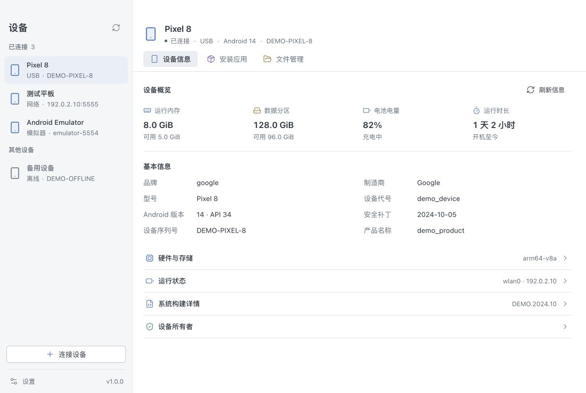
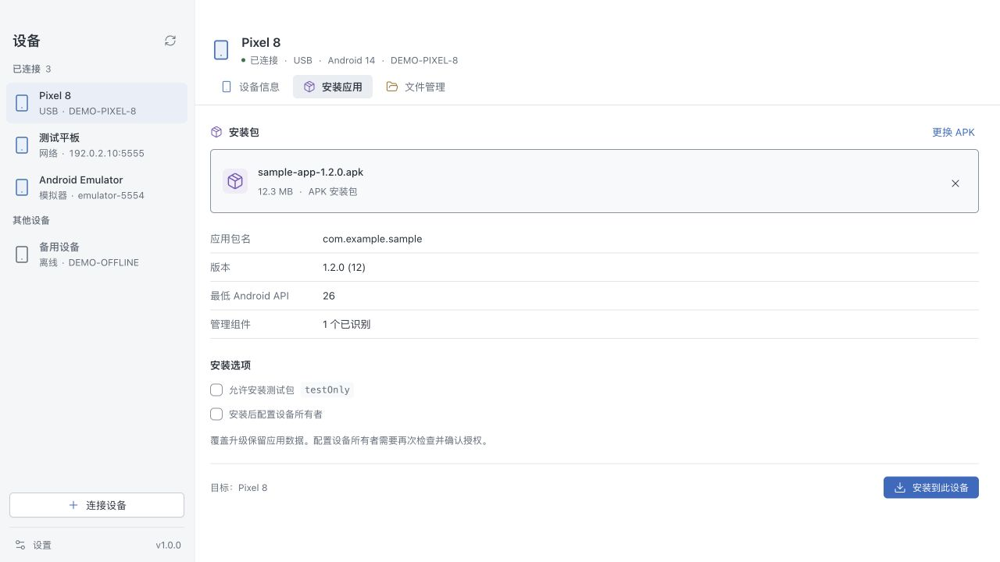
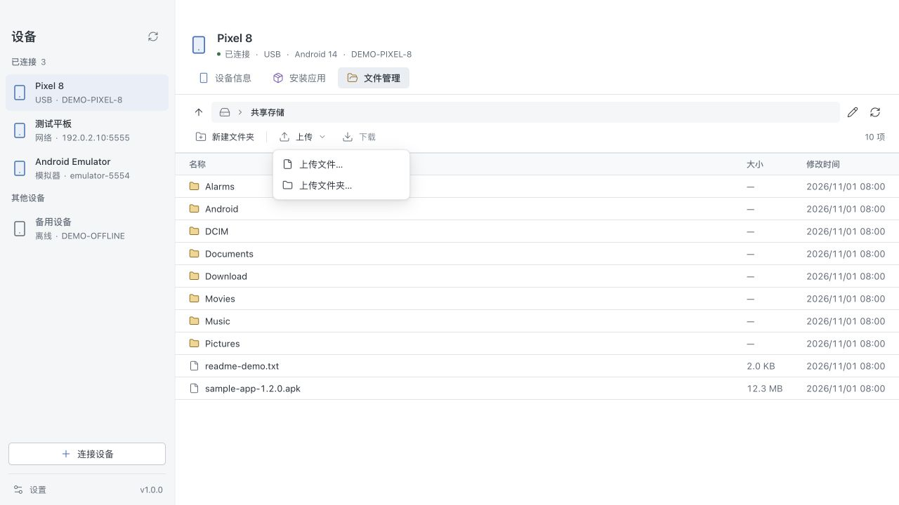

<div align="center">

# ADM

**Device manager for Android™**

在桌面上连接 Android 设备、安装应用、管理文件与配置设备所有者。

[](https://github.com/ruishanio/adm/actions/workflows/ci.yml)
[](https://github.com/ruishanio/adm/actions/workflows/package.yml)

**macOS Apple Silicon · Windows x64 · 简体中文 / English**

[下载安装](#下载安装) · [功能](#功能) · [快速开始](#快速开始) · [使用指南](docs/usage.md) · [参与开发](#参与开发)

</div>



<p align="center"><sub>界面截图来自当前源码中的实际组件，使用样例设备与文件数据。</sub></p>

ADM 将常用的 ADB 操作放进一个桌面工作台。通过 USB 或网络连接设备，在侧栏切换目标，即可查看信息、拖入 APK 安装，或浏览设备文件。发布包自带 ADB，无需另外安装 Android Studio、Java 或 .NET。

## 功能

| 功能               | 可以做什么                                                                                                        |
| ------------------ | ----------------------------------------------------------------------------------------------------------------- |
| **设备工作台**     | 自动发现 USB、网络与模拟器设备；分组查看系统构建、CPU、内存、存储、屏幕与电池；右键备注名称、复制标识或隐藏设备。 |
| **性能监控**       | 实时查看 CPU、各核心占用与频率、内存和网络曲线；查看电池温度，并按应用查看 HWUI 渲染 FPS、卡顿比例与 PSS 内存。 |
| **USB 与网络连接** | 提供 USB 调试指引、网络地址连接和 Android 11+ 无线调试配对。                                                      |
| **拖拽安装 APK**   | 读取包名、版本与管理组件，覆盖安装到主用户，完成后回读安装结果；支持显式允许测试包。                              |
| **已安装应用**     | 显示真实应用名称，按名称或包名搜索主用户的应用，查看版本、API、安装时间和路径；确认后卸载用户应用并回读结果，系统应用仅供查看。              |
| **设备所有者**     | 检查管理应用、现有所有者、用户和账号，确认授权后执行设置，并回读结果。                                            |
| **文件管理**       | 浏览目录、上传多个文件或文件夹、下载文件、新建文件夹，以及右键重命名和删除。                                      |
| **设备日志**       | 实时查看 Logcat，按应用、最低级别和关键词组合筛选，暂停滚动、导出已缓存日志，并突出显示崩溃信息。                  |
| **桌面体验**       | 可调侧栏、键盘快捷键、平台窗口控件，以及可随时切换的简体中文和英语界面。                                          |

<details>
<summary><strong>查看安装应用与文件管理界面</strong></summary>

### 安装应用

选择目标设备，拖入 APK，核对应用信息后安装。



### 文件管理

通过路径栏浏览设备目录，上传文件或文件夹，右键执行文件操作。



</details>

## 下载安装

当前版本：**0.1.1**，对应标签 `v0.1.1`。

发布流程完成后，可在 **[GitHub Releases](https://github.com/ruishanio/adm/releases)** 的 **Assets** 下载对应平台安装包。推送包含新发布流程的版本 tag 后，两个平台全部构建、安装验证及分发许可检查通过，才会自动发布；测试后缀 tag 标记为 **Pre-release**。

此前的测试构建仍可从 **[GitHub Actions → Package](https://github.com/ruishanio/adm/actions/workflows/package.yml)** 页面底部 **Artifacts** 下载。Actions 下载需要登录 GitHub，产物保留 **30 天**；历史 tag 不会因修改工作流自动补发 Release。

| 平台        | 系统要求                                      | 安装方式                                                                            |
| ----------- | --------------------------------------------- | ----------------------------------------------------------------------------------- |
| **macOS**   | Apple Silicon（ARM64），macOS 13.3 或更新版本 | 打开 `ADM-版本-mac-arm64.dmg`，将 ADM 拖入 Applications。                           |
| **Windows** | x64，Windows 10 / 11                          | 运行 `ADM-版本-win-x64-setup.exe`，按向导安装。缺少 WebView2 时，安装器会联网下载。 |

Release 同时提供两平台应用 ZIP、统一的 `SHA256SUMS.txt`，以及记录版本与提交的 `build-info-mac-arm64.json`、`build-info-win-x64.json`。Actions Artifact 内仍保留各平台的 `SHA256SUMS.txt` 和 `build-info.json`。Windows 便携 ZIP 需要系统已安装 WebView2。

> macOS 使用 ad-hoc 签名，尚未公证，Windows 尚未代码签名。仅提供以上两个平台的构建。

## 快速开始

1. **连接设备**：USB 连接时，先在 Android 上开启 USB 调试并确认授权；网络连接时，点击侧栏「连接设备」，填写调试地址，或先完成无线配对。
2. **选择目标**：在左侧设备列表选中设备，查看连接状态与系统信息。多台设备可以同时显示，每次操作作用于当前选中的设备。
3. **开始管理**：在「应用管理」点击「安装应用」，或直接拖入 APK 打开安装弹窗；在「文件管理」浏览和传输文件；需要配置设备所有者时，进入「设备信息 → 配置设备所有者」。

需要留意的操作边界：

- 无线调试的**配对端口与连接端口通常不同**，配对完成后仍需填写连接地址。
- 安装支持**单个完整 APK**，暂不支持 AAB、APKS 或拆分 APK。
- 设备所有者能否设置取决于设备状态与 Android 限制；ADM 不会移除账号、工作资料或已有所有者，也不会重置设备。

连接排查、文件操作规则与快捷键见 **[使用指南](docs/usage.md)**。

## 参与开发

ADM 使用 **Tauri 2 + Vue 3 + TypeScript**，界面基于 shadcn-vue、Tailwind CSS 4 与 Lucide。Rust 后端负责 ADB、APK 解析和本地配置；应用使用系统 WebView，不携带 Chromium 或 Node.js 运行时。

准备 Node.js 24、Python 3、仓库指定的 Rust 工具链及 [Tauri 平台依赖](https://v2.tauri.app/start/prerequisites/)，然后运行：

```sh
git clone https://github.com/ruishanio/adm.git
cd adm
npm ci
```

准备当前平台的 ADB 资源，选择对应命令执行一次：

```sh
# macOS Apple Silicon
python3 scripts/package_ci.py prepare mac arm64

# Windows x64
python scripts/package_ci.py prepare win x64
```

```sh
npm run dev
```

| 文档                                                 | 内容                                       |
| ---------------------------------------------------- | ------------------------------------------ |
| [使用指南](docs/usage.md)                            | 连接、安装、设备所有者、文件管理与常见问题 |
| [开发与构建](docs/development.md)                    | 环境、目录结构、测试、打包、CI 与配置存储  |
| [多语言方案](docs/i18n.md)                           | 语言选择、翻译范围与扩展方式               |
| [桌面设计约束](design-system/android-tool/MASTER.md) | 布局、交互与组件规范                       |
| [验证记录](VALIDATION.md)                            | 已执行的验证及其适用范围                   |

欢迎通过 [Issues](https://github.com/ruishanio/adm/issues) 反馈问题或提出建议。报告问题时，请附上 ADM 版本、电脑系统与架构、Android 版本、连接方式和复现步骤；日志与截图中请隐去设备标识、地址和个人文件信息。

提交改动前请阅读 [AGENTS.md](AGENTS.md)，运行与改动相关的检查，并在 PR 中说明行为变化与验证结果。

## 许可与第三方声明

ADM 自有代码采用 [MIT 许可](LICENSE)。第三方软件、复制组件及图形保持各自的许可，MIT 不覆盖第三方商标或独立运行时条款。

在应用中打开 **设置 → 第三方许可**，仅显示必要图形署名和适用的平台通知；点击“查看完整声明”可用系统文本应用离线阅读原文。安装包也附带可读的 `legal/` 目录，包含完整原文、Android 图形署名、WebView2 条款与隐私通知，以及五个 MPL 组件的精确版本源码归档。获取位置见 [源码说明](legal/SOURCE-CODE.md)，更新流程见 [许可材料维护](legal/README.md)。

当前 ADB 37.0.1 对应源码、libusb 重新链接材料，以及 Windows 最终分发核对仍有待办，见 [发布核对状态](legal/release-review.json)。目前继续官方 ADB 分发方案，并保留未核实事项；发布仍检查许可材料完整性和安装包。材料校验通过不等于所有分发义务已解决。

Android is a trademark of Google LLC.

The Android robot is reproduced or modified from work created and shared by Google and used according to terms described in the [Creative Commons 3.0 Attribution License](https://creativecommons.org/licenses/by/3.0/). ADM 对机器人颜色及其在设备底座上的布局进行了调整。

## 致谢

ADM 基于 [Tauri](https://tauri.app/)、[Vue](https://vuejs.org/)、[shadcn-vue](https://www.shadcn-vue.com/)、[Tailwind CSS](https://tailwindcss.com/) 和 [Lucide](https://lucide.dev/) 构建，设备连接使用 Google 官方 [Android SDK Platform-Tools](https://developer.android.com/tools/releases/platform-tools)。第三方声明随应用保留。
