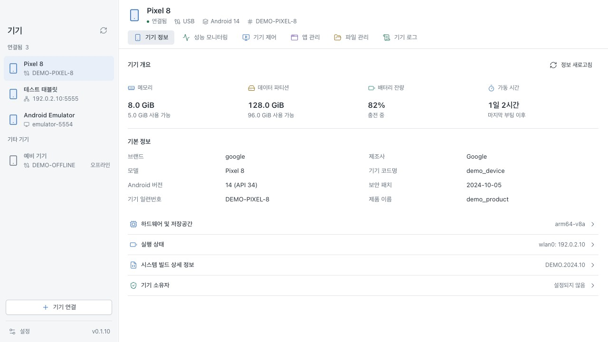
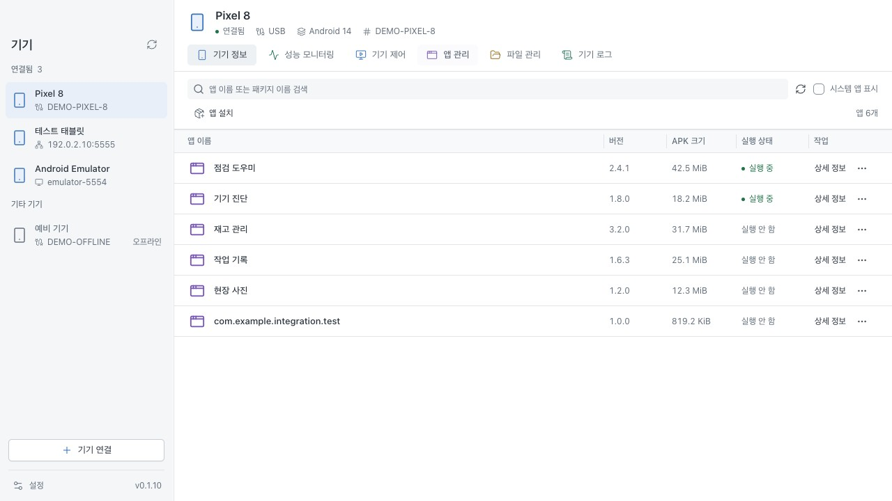
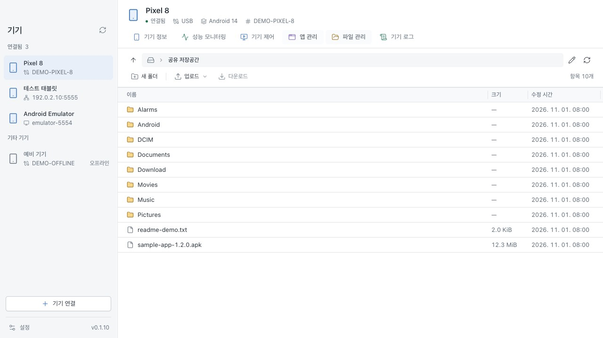

  

<h1 align="center">ADM</h1>

<strong>Device manager for Android</strong>

하나의 데스크톱 작업공간에서 Android 기기, 앱, 파일, 로그를 관리하세요.

  <a href="../../../README.md" lang="en">English</a> |
  <a href="README.zh-CN.md" lang="zh-CN">简体中文</a> |
  <a href="README.zh-TW.md" lang="zh-TW">繁體中文</a> |
  <a href="README.ja.md" lang="ja">日本語</a> |
  <strong>한국어</strong> |
  <a href="README.fr.md" lang="fr">Français</a> |
  <a href="README.de.md" lang="de">Deutsch</a> |
  <a href="README.es.md" lang="es">Español</a> |
  <a href="README.ru.md" lang="ru">Русский</a>

  <a href="https://adm.ruishanio.com/ko/">웹사이트</a> |
  <a href="https://github.com/ruishanio/adm/releases/latest">ADM 다운로드</a> |
  <a href="#기능">기능</a> |
  <a href="#시작하기">시작하기</a> |
  <a href="../../../CONTRIBUTING.md">기여하기</a> |
  <a href="https://github.com/ruishanio/adm/issues">문제 신고</a>

  
  

ADM은 macOS Apple Silicon과 Windows x64에서 사용할 수 있는 ADB 기반 오픈 소스 데스크톱 도구입니다. 휴대전화, 태블릿 또는 에뮬레이터를 연결해 앱과 파일을 관리하고, 화면을 제어하며, 성능과 로그를 확인할 수 있습니다. 배포 패키지에는 ADB가 포함되어 있습니다. 인터페이스는 영어, 중국어 간체·번체, 일본어, 한국어, 프랑스어, 독일어, 스페인어, 러시아어를 지원합니다. **설정 → 일반**에서 언어를 선택하면 즉시 적용되고 저장됩니다.

스크린샷은 현재 앱 구성요소와 예시 데이터를 사용합니다.

## 기능

- **기기 정보** — 시스템, 하드웨어, 저장공간, 배터리 정보를 확인하고 기기 소유자를 조회하거나 설정합니다.
- **성능 모니터링** — 실시간 CPU, 메모리, 네트워크 그래프와 앱 렌더링 FPS, 버벅임 비율, PSS 메모리 사용량을 확인합니다.
- **기기 제어** — 세로·가로 화면 미러링, 마우스와 키보드 입력, 스크린샷, 녹화, 텍스트 입력, 화면 회전, 재시작, 종료를 지원합니다.
- **앱 관리** — 이름이나 패키지 이름으로 검색하고 아이콘, 버전, APK 크기, 실행 상태를 확인합니다. 설치, 실행, 강제 종료, 데이터 삭제, 제거가 가능합니다.
- **파일 관리** — 폴더 탐색, 파일·폴더 업로드, 파일 다운로드, 폴더 생성, 이름 변경, 삭제를 지원합니다.
- **기기 로그** — 실시간 Logcat을 앱, 수준, 키워드, 비정상 종료 여부로 필터링하고 스크롤을 일시 정지하거나 로그를 내보냅니다.

USB 또는 네트워크로 연결하고, 여러 기기 사이를 전환하며, 사이드바와 표의 열 너비를 조절할 수 있습니다.

스크린샷 더 보기

**앱 관리**

**파일 관리**

## 다운로드

**[최신 릴리스](https://github.com/ruishanio/adm/releases/latest)**의 **Assets**에서 운영체제에 맞는 패키지를 다운로드하세요.

| 플랫폼 | 요구 사항 | 설치 파일 |
| --- | --- | --- |
| macOS | Apple Silicon, macOS 13.3 이상 | `ADM-<version>-mac-arm64.dmg` |
| Windows | x64, Windows 10 / 11 | `ADM-<version>-win-x64-setup.exe` |

- **macOS**: DMG를 열고 ADM을 응용 프로그램 폴더로 드래그하세요.
- **Windows**: 설치 프로그램을 실행하세요. WebView2가 없으면 자동으로 다운로드합니다.
- 두 플랫폼 모두 ZIP 패키지도 제공합니다. Windows ZIP 버전은 WebView2가 미리 설치되어 있어야 합니다. 압축을 푼 후 `adm.exe`를 실행하세요. `Source code` 파일은 설치 프로그램이 아닙니다.

최신 공식 macOS 릴리스는 Developer ID로 서명되고 Apple 공증을 받았습니다. Windows 설치 프로그램에는 아직 Authenticode 서명이 없어 실행 시 보안 알림이 표시될 수 있습니다. 현재 미리 빌드된 패키지는 위의 두 플랫폼을 대상으로 합니다.

## 시작하기

1. Android 개발자 옵션에서 **USB 디버깅**을 켜고 데이터 케이블로 연결한 후 기기에 표시되는 디버깅 승인 요청을 허용하세요.
2. ADM을 열고 사이드바에서 연결된 기기를 선택하세요.
3. 필요한 탭을 여세요. 예를 들어 **앱 관리 → 앱 설치**를 선택하거나 APK를 창에 드래그하면 설치를 시작할 수 있습니다.

무선 연결은 왼쪽 아래의 **기기 연결**에서 설정합니다. Android 11 이상은 무선 디버깅 페어링을 지원합니다. **페어링 주소와 연결 주소는 서로 다릅니다.** 페어링 후에는 연결 포트로 접속하세요. 네트워크 디버깅이 이미 활성화된 경우 기기의 `IP:포트`를 직접 입력할 수 있습니다.

ADM을 실행하기 위해 Android Studio, Java, FFmpeg 또는 scrcpy 데스크톱 클라이언트를 별도로 설치할 필요는 없습니다.

## 자주 묻는 질문

ADM은 어떻게 업데이트하나요?

ADM 0.1.8부터 앱 내 업데이트를 지원합니다. **설정 → 정보** 또는 사이드바 알림에서 최신 버전을 다운로드한 후 설치와 재시작 시점을 선택할 수 있습니다. 이전 버전 사용자는 최신 버전을 직접 설치해야 하며, Windows 포터블 버전 사용자는 새 ZIP을 다운로드해야 합니다.

기기가 연결되지 않거나 미러링 화면이 검게 표시되면 어떻게 하나요?

먼저 기기의 잠금을 해제하고 USB 디버깅을 승인하세요. 무선 연결에서는 네트워크 연결 상태와 주소·포트를 확인하세요. 미러링에는 시스템 WebView의 WebCodecs 지원이 필요합니다. Android 6.0 이상을 실행하는 x86_64 기기에서 시스템 H.264 인코더가 실패하면 ADM이 자동으로 호환 인코더로 전환합니다. 캡처가 보호된 화면은 여전히 검게 표시될 수 있습니다. 보호되지 않은 화면으로 돌아간 후 **다시 연결**을 시도하세요.

녹화와 클립보드에는 어떤 제한이 있나요?

현재 미러링과 녹화에는 소리가 포함되지 않습니다. 화면 방향이나 크기가 바뀌거나, 기기를 전환하거나, 기기 제어 탭을 벗어나면 녹화가 종료되고 저장됩니다. 클립보드는 양방향으로 자동 동기화되지 않습니다. **텍스트 입력**을 실행하면 지정한 텍스트를 기기 클립보드에 기록하고 붙여넣습니다.

앱, 성능, 로그 데이터는 어떻게 해석하나요?

- **실행 중**에는 백그라운드 및 캐시된 프로세스도 포함되므로 앱이 화면에 표시되고 있다는 뜻은 아닙니다. **APK 크기**에는 앱 데이터와 캐시가 포함되지 않습니다.
- 앱 프레임 속도는 HWUI 통계를 기반으로 하며 앱의 렌더링 방식에 따라 수집 범위가 달라집니다. PSS는 프로세스의 메모리 사용량입니다.
- **스크롤 일시 정지** 중에도 새 로그를 계속 수신합니다. 내보내기는 현재 필터와 일치하는 캐시된 로그를 저장하며, 캐시에는 용량 제한이 있습니다.

앱 설치, 파일 접근, 기기 소유자 설정에는 어떤 제한이 있나요?

앱 관리는 기본 사용자(사용자 0)를 대상으로 합니다. 설치는 하나의 완전한 APK를 지원하며 AAB, APKS 또는 분할 APK 설치는 지원하지 않습니다. 시스템 앱은 조회만 가능합니다. 현재 기기 소유자 앱은 강제 종료, 데이터 삭제 또는 제거할 수 없습니다.

파일 접근은 ADB 권한으로 제한됩니다. 기기 소유자 설정은 Android의 사용자, 계정, 관리 구성요소 조건을 충족해야 합니다. ADM은 계정, 직장 프로필 또는 기존 소유자를 자동으로 제거하거나 기기를 초기화하지 않습니다.

## 기여하기

버그나 개선 제안은 [Issues](https://github.com/ruishanio/adm/issues)에 등록해 주세요. ADM 버전, 데스크톱 운영체제, Android 버전, 연결 방식, 재현 방법을 함께 적어 주세요. 로그나 스크린샷을 공유하기 전에 개인 정보를 삭제해 주세요.

ADM은 **Tauri 2, Vue 3, TypeScript, Rust**를 사용합니다. 개발 환경 설정, 검사, 패키징 방법은 [기여 가이드(영어)](../../../CONTRIBUTING.md)를 참고하세요.

## 라이선스 및 감사의 말

ADM 자체 코드는 [MIT 라이선스](../../../LICENSE)를 따릅니다. [중국어 간체 참고 번역](../../../LICENSE.zh-CN.md)도 제공됩니다. 타사 구성요소와 리소스에는 각각의 라이선스가 적용됩니다.

[Tauri](https://tauri.app/), [Vue](https://vuejs.org/), [shadcn-vue](https://www.shadcn-vue.com/), [Tailwind CSS](https://tailwindcss.com/), [Lucide](https://lucide.dev/), [Android SDK Platform-Tools](https://developer.android.com/tools/releases/platform-tools), [scrcpy](https://github.com/Genymobile/scrcpy)에 감사드립니다.

기기 제어용 데스크톱 클라이언트는 Rust로 구현되어 있으며 Android 측에서는 ADM이 수정한 scrcpy 서버를 사용합니다. 소스와 라이선스는 [서버 설명(중국어 간체)](../../../src-tauri/resources/scrcpy/README.md)을 참고하세요. 배포 패키지에는 ADB의 NOTICE와 scrcpy 서버의 Apache-2.0 라이선스가 포함됩니다.

Android is a trademark of Google LLC.

The Android robot is reproduced or modified from work created and shared by Google and used according to terms described in the [Creative Commons 3.0 Attribution License](https://creativecommons.org/licenses/by/3.0/). ADM은 로봇의 색상과 기기 도크 위의 배치를 변경했습니다.
