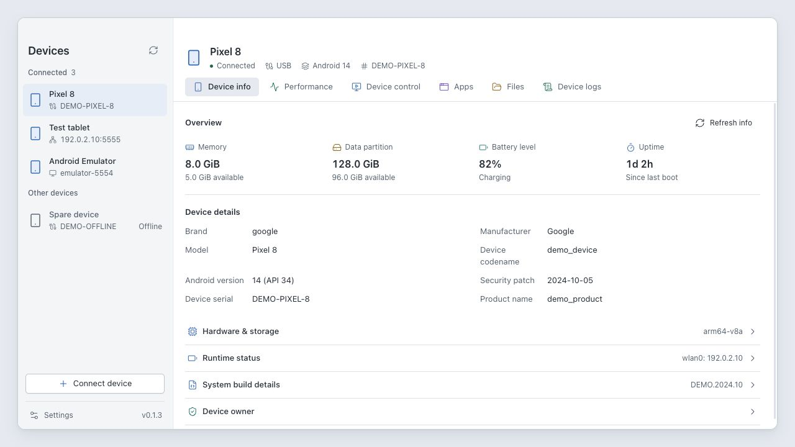
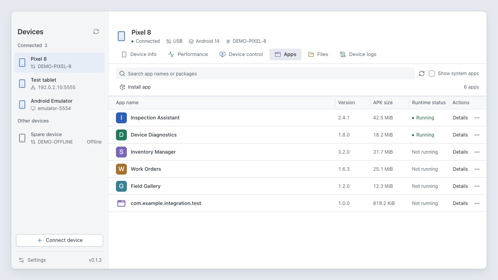
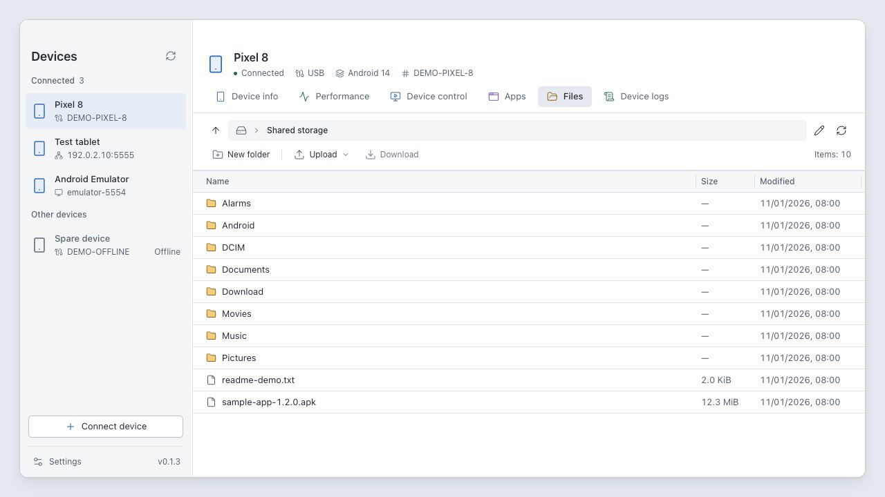

  

<h1 align="center">ADM</h1>

<strong>Device manager for Android</strong>

Управляйте Android-устройствами, приложениями, файлами и журналами в одном рабочем пространстве.

  <a href="../../../README.md" lang="en">English</a> |
  <a href="README.zh-CN.md" lang="zh-CN">简体中文</a> |
  <a href="README.zh-TW.md" lang="zh-TW">繁體中文</a> |
  <a href="README.ja.md" lang="ja">日本語</a> |
  <a href="README.fr.md" lang="fr">Français</a> |
  <a href="README.de.md" lang="de">Deutsch</a> |
  <a href="README.es.md" lang="es">Español</a> |
  <strong>Русский</strong>

  <a href="https://adm.ruishanio.com">Официальный сайт</a> |
  <a href="https://github.com/ruishanio/adm/releases/latest">Скачать ADM</a> |
  <a href="#возможности">Возможности</a> |
  <a href="#начало-работы">Начало работы</a> |
  <a href="../../../CONTRIBUTING.md">Разработка</a> |
  <a href="https://github.com/ruishanio/adm/issues">Сообщить об ошибке</a>

  
  

ADM — настольный инструмент с открытым исходным кодом на базе ADB для macOS Apple Silicon и Windows x64. Подключите телефон, планшет или эмулятор, чтобы управлять приложениями и файлами, работать с экраном устройства и просматривать показатели производительности и журналы. ADB входит в пакеты выпуска. Интерфейс доступен на английском, упрощённом и традиционном китайском, японском, французском, немецком, испанском и русском языках. Язык выбирается в разделе «Настройки → Общие», применяется сразу и сохраняется.

Снимки показывают текущий английский интерфейс с демонстрационными данными.

## Возможности

- **Сведения об устройстве** — Просмотр данных о системе, оборудовании, хранилище и батарее; проверка и настройка владельца устройства (Device Owner).
- **Производительность** — Графики загрузки CPU, памяти и сети в реальном времени, а также FPS отрисовки, доля кадров с задержкой и память PSS приложений.
- **Управление устройством** — Трансляция экрана в портретной и альбомной ориентации, управление мышью и клавиатурой, снимки экрана, запись видео, ввод текста, поворот, перезагрузка и выключение.
- **Приложения** — Поиск по имени или имени пакета; значки, версии, размеры APK и состояние процессов; установка, запуск, принудительная остановка, очистка данных и удаление.
- **Файлы** — Просмотр каталогов, отправка файлов и папок на устройство, скачивание файлов, создание папок, переименование и удаление.
- **Журналы устройства** — Logcat в реальном времени с фильтрами по приложению, уровню, ключевому слову и сбоям; приостановка прокрутки и экспорт журналов.

Поддерживаются подключение по USB и сети, переключение между устройствами и изменение ширины боковой панели и столбцов таблиц.

Другие снимки экрана

**Приложения**

**Файлы**

## Загрузка

Откройте **[последний выпуск](https://github.com/ruishanio/adm/releases/latest)** и скачайте пакет для своей системы в разделе **Assets**.

| Платформа | Требования                          | Установщик                        |
| --------- | ----------------------------------- | --------------------------------- |
| macOS     | Apple Silicon, macOS 13.3 или новее | `ADM-<version>-mac-arm64.dmg`     |
| Windows   | x64, Windows 10 / 11                | `ADM-<version>-win-x64-setup.exe` |

- **macOS**: откройте DMG и перетащите ADM в Applications.
- **Windows**: запустите установщик. Если WebView2 отсутствует, установщик скачает его.
- Для обеих платформ доступны ZIP-архивы. ZIP-версия для Windows требует установленного WebView2: распакуйте архив и запустите `adm.exe`. Архивы `Source code` содержат исходный код, а не установщик.

Последняя официальная версия для macOS подписана сертификатом Developer ID и прошла нотариализацию Apple. Установщик Windows пока не имеет подписи Authenticode, поэтому при его запуске Windows может показать предупреждение безопасности. Готовые пакеты сейчас доступны для двух платформ из таблицы.

## Начало работы

1. Включите **отладку по USB** в параметрах разработчика Android, подключите устройство кабелем для передачи данных и подтвердите запрос на разрешение отладки на устройстве.
2. Откройте ADM и выберите подключённое устройство на боковой панели.
3. Перейдите на нужную вкладку. Например, выберите **Apps → Install app** или перетащите APK в окно, чтобы начать установку.

Для беспроводного подключения нажмите **Connect device** внизу слева. В Android 11 и новее доступно сопряжение для беспроводной отладки. **Адреса сопряжения и подключения различаются**: после сопряжения используйте порт подключения. Если сетевая отладка уже включена, можно сразу ввести `IP:порт`.

Для работы ADM не нужно отдельно устанавливать Android Studio, Java, FFmpeg или настольный клиент scrcpy.

## Частые вопросы

Как обновить ADM?

ADM 0.1.8 и более поздние версии поддерживают обновление в приложении. Загрузите последнюю версию через «Настройки → О программе» или уведомление на боковой панели и выберите время установки и перезапуска. Для более ранних версий установите последнюю версию вручную; для портативной версии Windows скачайте новый ZIP.

Почему устройство не подключается или вместо экрана отображается чёрное поле?

Сначала разблокируйте устройство и разрешите отладку по USB. При беспроводном подключении проверьте доступность устройства по сети, адрес и порт. Для трансляции нужна поддержка WebCodecs в системном WebView. При сбое системного кодировщика H.264 на устройстве x86_64 с Android 6.0 или новее ADM автоматически переключается на совместимый кодировщик. Защищённые от захвата экраны могут по-прежнему отображаться чёрными. Вернитесь на обычный экран и попробуйте **Reconnect**.

Какие ограничения есть у записи видео и буфера обмена?

Трансляция и запись пока не включают звук. При изменении ориентации или размеров экрана, переключении устройства или выходе с вкладки управления текущая запись завершается и сохраняется. Буфер обмена не синхронизируется автоматически в обоих направлениях. **Enter text** записывает указанный текст в буфер обмена устройства и вставляет его.

Как понимать данные о приложениях, производительности и журналах?

- **Running** включает фоновые и кэшированные процессы и не означает, что приложение открыто на переднем плане. **APK size** не учитывает данные и кэш приложения.
- Частота кадров приложения берётся из статистики HWUI; охват зависит от способа отрисовки. PSS отражает использование памяти процессами.
- **Pause scrolling** не останавливает получение новых записей. Экспорт сохраняет кэшированные записи, соответствующие текущим фильтрам; объём кэша ограничен.

Каковы ограничения установки приложений, доступа к файлам и настройки владельца устройства?

Управление приложениями относится к основному пользователю (пользователь 0). Поддерживается установка одного полного APK, но не AAB, APKS или раздельных APK. Системные приложения доступны только для просмотра. ADM не позволяет принудительно остановить, очистить данные или удалить приложение, которое является текущим владельцем устройства.

Доступ к файлам ограничен правами ADB. Для настройки владельца устройства необходимо выполнить требования Android к пользователям, учётным записям и компонентам администрирования. ADM не удаляет автоматически учётные записи, рабочие профили или существующих владельцев и не выполняет сброс к заводским настройкам.

## Участие в разработке

Сообщайте об ошибках и предлагайте улучшения через [Issues](https://github.com/ruishanio/adm/issues). Укажите версию ADM, ОС компьютера, версию Android, способ подключения и шаги воспроизведения. Перед публикацией журналов или снимков экрана удалите личные данные.

ADM использует **Tauri 2, Vue 3, TypeScript и Rust**. Подготовка среды, проверки и сборка пакетов описаны в [руководстве для участников на английском](../../../CONTRIBUTING.md).

## Лицензия и благодарности

Собственный код ADM распространяется по [лицензии MIT](../../../LICENSE). Сторонние компоненты и ресурсы сохраняют свои лицензии.

Благодарим проекты [Tauri](https://tauri.app/), [Vue](https://vuejs.org/), [shadcn-vue](https://www.shadcn-vue.com/), [Tailwind CSS](https://tailwindcss.com/), [Lucide](https://lucide.dev/), [Android SDK Platform-Tools](https://developer.android.com/tools/releases/platform-tools) и [scrcpy](https://github.com/Genymobile/scrcpy).

Настольный клиент управления устройством реализован на Rust, а на стороне Android используется версия сервера scrcpy с изменениями ADM. Источник и лицензия указаны в [описании сервера на упрощённом китайском](../../../src-tauri/resources/scrcpy/README.md). В пакетах сохраняются файл NOTICE от ADB и лицензия Apache-2.0 сервера scrcpy.

Android is a trademark of Google LLC.

The Android robot is reproduced or modified from work created and shared by Google and used according to terms described in the [Creative Commons 3.0 Attribution License](https://creativecommons.org/licenses/by/3.0/). ADM изменяет цвет робота и его расположение на подставке для устройств.
