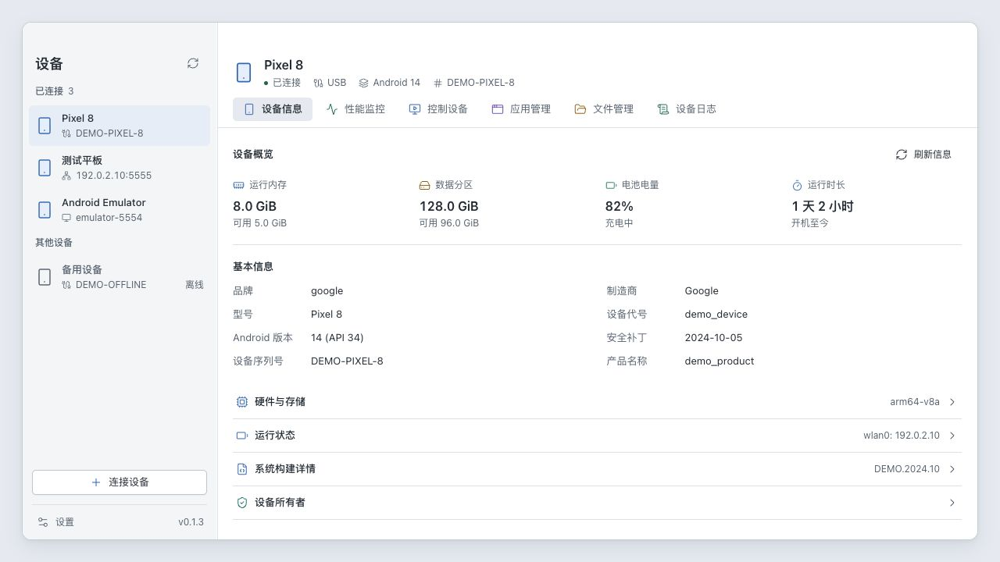
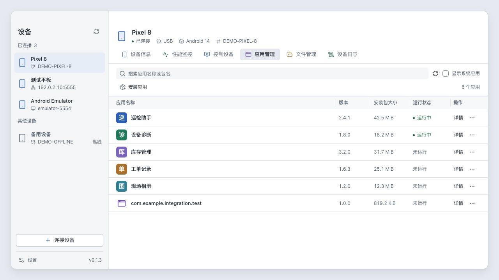
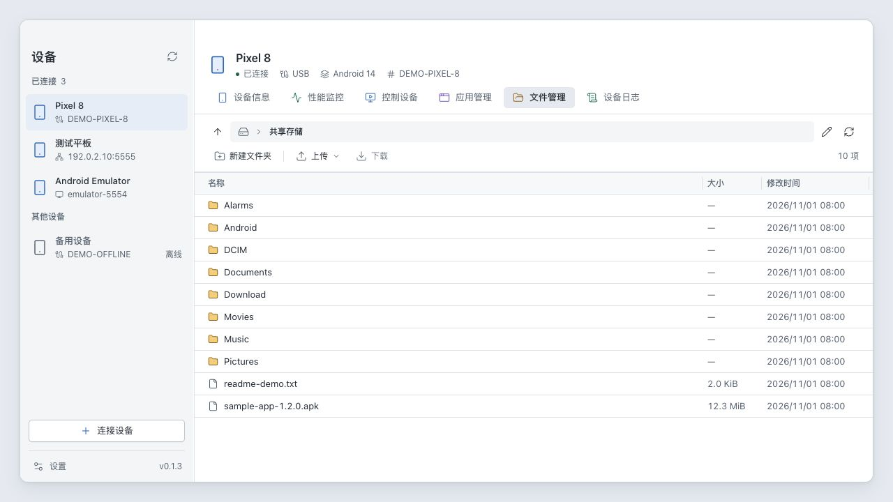

  

<h1 align="center">ADM</h1>

<strong>Device manager for Android</strong>

在一个桌面工作台中管理 Android 设备、应用、文件与日志。

  <a href="../../../README.md" lang="en">English</a> |
  <strong>简体中文</strong> |
  <a href="README.zh-TW.md" lang="zh-TW">繁體中文</a> |
  <a href="README.ja.md" lang="ja">日本語</a> |
  <a href="README.fr.md" lang="fr">Français</a> |
  <a href="README.de.md" lang="de">Deutsch</a> |
  <a href="README.es.md" lang="es">Español</a> |
  <a href="README.ru.md" lang="ru">Русский</a>

  <a href="https://github.com/ruishanio/adm/releases/latest">下载 ADM</a> |
  <a href="#功能">功能</a> |
  <a href="#快速开始">上手</a> |
  <a href="CONTRIBUTING.zh-CN.md">参与开发</a> |
  <a href="https://github.com/ruishanio/adm/issues">反馈问题</a>

  
  

ADM 是一款基于 ADB 的开源桌面工具，支持 macOS Apple Silicon 和 Windows x64。连接手机、平板或模拟器，即可管理应用与文件、操作设备画面、查看性能与日志。发布包内置 ADB，界面支持简体中文和 English。

截图使用当前界面组件与演示数据。

## 功能

- **设备信息** — 查看系统、硬件、存储和电池信息，检查与配置设备所有者。
- **性能监控** — CPU、内存与网络实时曲线，应用渲染 FPS、卡顿比例及 PSS 内存。
- **控制设备** — 鼠标、键盘操作与横竖屏投屏，截图、录像、文本输入、旋转、重启与关机。
- **应用管理** — 搜索名称或包名，查看图标、版本、安装包大小和运行状态；安装、打开、强制停止、清除数据与卸载。
- **文件管理** — 浏览目录、上传文件或文件夹、下载文件、新建文件夹、重命名与删除。
- **设备日志** — 实时 Logcat，按应用、级别、关键词和崩溃筛选，暂停滚动与导出日志。

支持 USB 与网络连接、多设备切换，以及侧栏和列表列宽调整。

更多截图

**应用管理**

**文件管理**

## 下载

前往 **[最新 Release](https://github.com/ruishanio/adm/releases/latest)**，在 **Assets** 中下载对应安装包。

| 平台    | 系统要求                   | 安装包                         |
| ------- | -------------------------- | ------------------------------ |
| macOS   | Apple Silicon，macOS 13.3+ | `ADM-<版本>-mac-arm64.dmg`     |
| Windows | x64，Windows 10 / 11       | `ADM-<版本>-win-x64-setup.exe` |

- **macOS**：打开 DMG，将 ADM 拖入 Applications。
- **Windows**：运行安装向导；缺少 WebView2 时，安装器会联网下载。
- 两个平台均提供 ZIP。Windows ZIP 需已有 WebView2，解压后运行 `adm.exe`。`Source code` 是源码，不是安装包。

macOS 构建尚未公证，Windows 构建尚未代码签名，首次打开可能遇到系统安全提示。当前提供的构建目标为上表两项。

## 快速开始

1. 在 Android 开发者选项中开启 **USB 调试**，用数据线连接电脑，并在设备上确认授权。
2. 打开 ADM，在左侧选中已连接的设备。
3. 进入所需标签页。例如在「应用管理」点击「安装应用」，或将 APK 拖入窗口开始安装。

无线连接通过左下角「连接设备」完成。Android 11+ 可使用无线调试配对；**配对地址和连接地址是两回事**，配对完成后需使用连接端口连接。已有网络调试地址的设备可直接填写 `IP:端口`。

运行 ADM 无需另外安装 Android Studio、Java、FFmpeg 或 scrcpy 桌面客户端。

## 常见问题

设备未连接，或投屏黑屏怎么办？

先解锁设备并确认 USB 调试授权；无线连接请检查网络是否互通、地址与端口是否正确。投屏还依赖设备的 H.264 编码器和系统 WebView 的 WebCodecs 支持，部分旧模拟器可能无法编码，受防截屏保护的页面也可能黑屏。可返回普通页面，再点击「重新连接」。

录像和剪贴板有什么限制？

投屏与录像目前不含音频。画面方向或尺寸变化、切换设备或离开控制页时，会结束并保存当前录像。剪贴板不会自动双向同步，仅在「输入文本」时写入设备剪贴板并粘贴。

应用、性能和日志数据如何理解？

- 应用「运行中」包含后台及缓存进程，不等于正在前台使用；「安装包大小」不包含数据和缓存。
- 应用帧率来自 HWUI 统计，覆盖范围取决于应用渲染方式；PSS 是进程内存占用。
- 日志「暂停滚动」仍会接收新日志；导出保存当前筛选下的已缓存日志，缓存有容量限制。

应用安装、文件访问与设备所有者有哪些边界？

应用管理针对主用户（用户 0），安装支持单个完整 APK，暂不支持 AAB、APKS 或拆分 APK 安装。系统应用仅供查看，当前设备所有者应用不能强制停止、清除数据或卸载。

文件访问受 ADB 权限限制。配置设备所有者须满足 Android 的用户、账号和管理组件条件；ADM 不会自动移除账号、工作资料、已有所有者或恢复出厂设置。

## 参与贡献

欢迎通过 [Issues](https://github.com/ruishanio/adm/issues) 反馈问题或提出建议。请附上 ADM 版本、电脑系统、Android 版本、连接方式和复现步骤；分享日志或截图前请隐去私人数据。

项目使用 **Tauri 2、Vue 3、TypeScript 与 Rust**。开发环境、启动命令、检查和打包方式见 [贡献指南](CONTRIBUTING.zh-CN.md)。

## 许可与致谢

ADM 自有代码采用 [MIT 许可](../../../LICENSE)，另附[简体中文参考译文](../../../LICENSE.zh-CN.md)。第三方组件与资源遵循各自许可。

感谢 [Tauri](https://tauri.app/)、[Vue](https://vuejs.org/)、[shadcn-vue](https://www.shadcn-vue.com/)、[Tailwind CSS](https://tailwindcss.com/)、[Lucide](https://lucide.dev/)、[Android SDK Platform-Tools](https://developer.android.com/tools/releases/platform-tools) 和 [scrcpy](https://github.com/Genymobile/scrcpy)。

设备控制的桌面端由 Rust 实现，Android 端复用官方 scrcpy 服务端，来源与许可见 [服务端说明](../../../src-tauri/resources/scrcpy/README.md)。随包保留 ADB 的 NOTICE 和 scrcpy 服务端的 Apache-2.0 许可。

Android is a trademark of Google LLC.

The Android robot is reproduced or modified from work created and shared by Google and used according to terms described in the [Creative Commons 3.0 Attribution License](https://creativecommons.org/licenses/by/3.0/). ADM 对机器人颜色及其在设备底座上的布局进行了调整。
