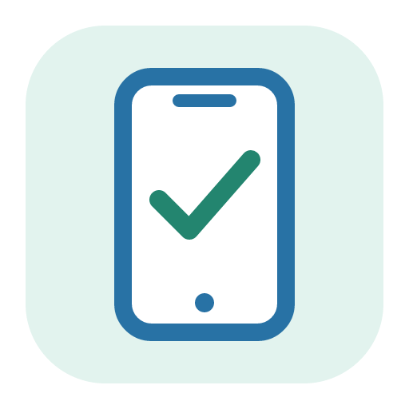
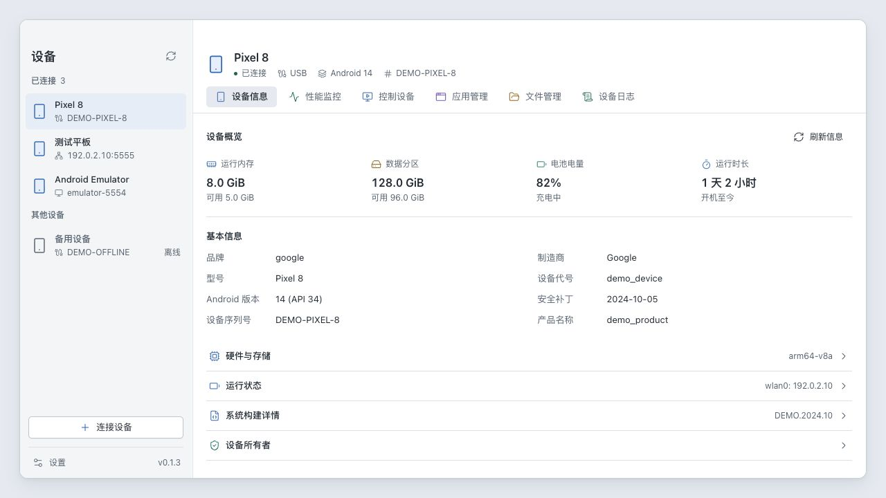
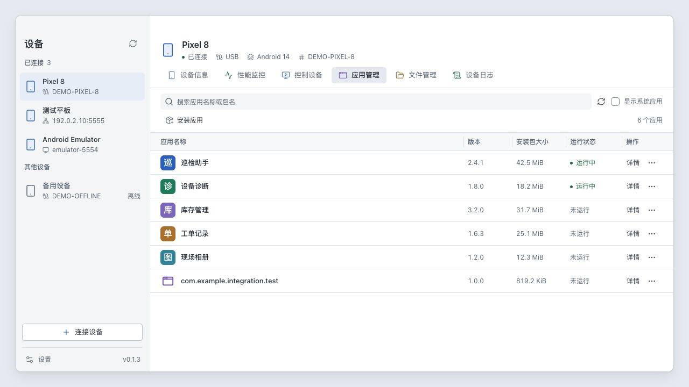
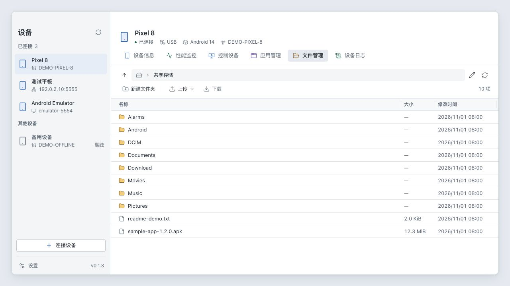

  

<h1 align="center">ADM</h1>

<strong>Device manager for Android</strong>

在同一個桌面工作區管理 Android 裝置、應用程式、檔案與日誌。

  <a href="../../../README.md" lang="en">English</a> |
  <a href="README.zh-CN.md" lang="zh-CN">简体中文</a> |
  <strong>繁體中文</strong> |
  <a href="README.ja.md" lang="ja">日本語</a> |
  <a href="README.fr.md" lang="fr">Français</a> |
  <a href="README.de.md" lang="de">Deutsch</a> |
  <a href="README.es.md" lang="es">Español</a> |
  <a href="README.ru.md" lang="ru">Русский</a>

  <a href="https://github.com/ruishanio/adm/releases/latest">下載 ADM</a> |
  <a href="#功能">功能</a> |
  <a href="#快速開始">開始使用</a> |
  <a href="../../../CONTRIBUTING.md">參與開發</a> |
  <a href="https://github.com/ruishanio/adm/issues">回報問題</a>

  
  

ADM 是一款以 ADB 為基礎的開源桌面工具，支援 macOS Apple Silicon 和 Windows x64。連接手機、平板或模擬器，即可管理應用程式與檔案、操作裝置畫面、查看效能與日誌。發行套件內含 ADB，應用程式介面支援英文、簡體中文、繁體中文、日文、法文、德文、西班牙文與俄文，可於「設定 → 一般」切換，即時生效並儲存。

截圖使用目前的介面元件與示範資料，畫面為簡體中文介面。

## 功能

- **裝置資訊** — 查看系統、硬體、儲存空間和電池資訊，檢查與設定裝置擁有者（Device Owner）。
- **效能監控** — CPU、記憶體與網路即時圖表，以及應用程式的繪製 FPS、卡頓比例與 PSS 記憶體用量。
- **控制裝置** — 滑鼠與鍵盤操作、直向與橫向螢幕鏡像、螢幕擷取、錄影、文字輸入、旋轉、重新啟動與關機。
- **應用程式管理** — 依名稱或套件名稱搜尋，查看圖示、版本、APK 大小與執行狀態；安裝、開啟、強制停止、清除資料與解除安裝。
- **檔案管理** — 瀏覽目錄、上傳檔案或資料夾、下載檔案、新增資料夾、重新命名與刪除。
- **裝置日誌** — 即時 Logcat，依應用程式、等級、關鍵字與當機資訊篩選，暫停捲動與匯出日誌。

支援 USB 與網路連線、多裝置切換，以及側邊欄和表格欄寬調整。

更多截圖

**應用程式管理**

**檔案管理**

## 下載

前往 **[最新版本](https://github.com/ruishanio/adm/releases/latest)**，在 **Assets** 中下載適合您系統的安裝套件。

| 平台    | 系統需求                   | 安裝套件                       |
| ------- | -------------------------- | ------------------------------ |
| macOS   | Apple Silicon，macOS 13.3+ | `ADM-<版本>-mac-arm64.dmg`     |
| Windows | x64，Windows 10 / 11       | `ADM-<版本>-win-x64-setup.exe` |

- **macOS**：開啟 DMG，將 ADM 拖入 Applications。
- **Windows**：執行安裝精靈；若缺少 WebView2，安裝程式會連線下載。
- 兩個平台均提供 ZIP。Windows ZIP 需要已安裝 WebView2，解壓縮後執行 `adm.exe`。`Source code` 是原始碼封存檔，不是安裝程式。

macOS 版本尚未通過公證，Windows 版本尚未進行程式碼簽署，首次開啟時可能出現系統安全提示。目前提供的預先編譯版本僅涵蓋上表兩項。

## 快速開始

1. 在 Android 開發人員選項中開啟 **USB 偵錯**，使用可傳輸資料的線材連接電腦，並在裝置上確認授權。
2. 開啟 ADM，在左側選取已連線的裝置。
3. 進入所需分頁。例如在應用程式管理中點選安裝應用程式，或將 APK 拖入視窗開始安裝。

無線連線可透過左下角的連接裝置功能完成。Android 11+ 支援無線偵錯配對；**配對位址與連線位址不同**，配對後須使用連線連接埠。已啟用網路偵錯的裝置可直接輸入 `IP:連接埠`。

執行 ADM 不需要另外安裝 Android Studio、Java、FFmpeg 或 scrcpy 桌面用戶端。

## 常見問題

裝置無法連線，或螢幕鏡像顯示黑畫面？

請先解鎖裝置並確認 USB 偵錯授權；無線連線請檢查網路是否互通，以及位址和連接埠是否正確。螢幕鏡像還需要裝置上可正常使用的 H.264 編碼器，以及系統 WebView 的 WebCodecs 支援。部分舊版模擬器可能無法編碼，受螢幕擷取保護的畫面也可能顯示黑畫面。可返回一般畫面，再點選重新連線。

錄影與剪貼簿有哪些限制？

目前螢幕鏡像與錄影不含音訊。畫面方向或尺寸變更、切換裝置或離開控制分頁時，會停止並儲存目前的錄影。剪貼簿不會自動雙向同步，僅在輸入文字時將指定文字寫入裝置剪貼簿並貼上。

如何解讀應用程式、效能與日誌資料？

- 執行中的應用程式包含背景及快取處理程序，不代表正在前景使用；APK 大小不含應用程式資料與快取。
- 應用程式影格率來自 HWUI 統計，涵蓋範圍取決於繪製方式；PSS 表示處理程序的記憶體用量。
- 暫停捲動時仍會接收新日誌；匯出會儲存符合目前篩選條件的已快取日誌，快取有容量限制。

應用程式安裝、檔案存取與裝置擁有者設定有哪些限制？

應用程式管理針對主要使用者（使用者 0），安裝支援單一完整 APK，暫不支援 AAB、APKS 或分割 APK 安裝。系統應用程式僅供檢視；目前的裝置擁有者應用程式無法透過 ADM 強制停止、清除資料或解除安裝。

檔案存取受 ADB 權限限制。設定裝置擁有者須符合 Android 對使用者、帳戶與管理元件的要求；ADM 不會自動移除帳戶、工作設定檔、既有擁有者，或恢復原廠設定。

## 參與貢獻

歡迎透過 [Issues](https://github.com/ruishanio/adm/issues) 回報問題或提出建議。請提供 ADM 版本、電腦作業系統、Android 版本、連線方式與重現步驟；分享日誌或截圖前，請先移除私人資料。

專案使用 **Tauri 2、Vue 3、TypeScript 與 Rust**。開發環境、啟動命令、檢查與封裝方式請見 [貢獻指南（英文）](../../../CONTRIBUTING.md)。

## 授權與致謝

ADM 自有程式碼採用 [MIT 授權](../../../LICENSE)，第三方元件與資源遵循各自的授權。

感謝 [Tauri](https://tauri.app/)、[Vue](https://vuejs.org/)、[shadcn-vue](https://www.shadcn-vue.com/)、[Tailwind CSS](https://tailwindcss.com/)、[Lucide](https://lucide.dev/)、[Android SDK Platform-Tools](https://developer.android.com/tools/releases/platform-tools) 和 [scrcpy](https://github.com/Genymobile/scrcpy)。

裝置控制的桌面用戶端以 Rust 實作，Android 端使用以 scrcpy 為基礎修改的 ADM 伺服器；來源與授權請見 [伺服器說明（簡體中文）](../../../src-tauri/resources/scrcpy/README.md)。發行套件保留 ADB 的 NOTICE 與 scrcpy 伺服器的 Apache-2.0 授權。

Android is a trademark of Google LLC.

The Android robot is reproduced or modified from work created and shared by Google and used according to terms described in the [Creative Commons 3.0 Attribution License](https://creativecommons.org/licenses/by/3.0/). ADM 調整了機器人的顏色及其在裝置底座上的位置。
